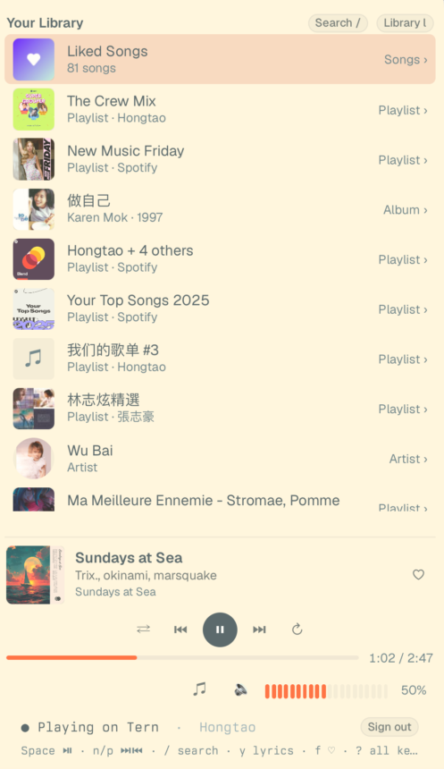
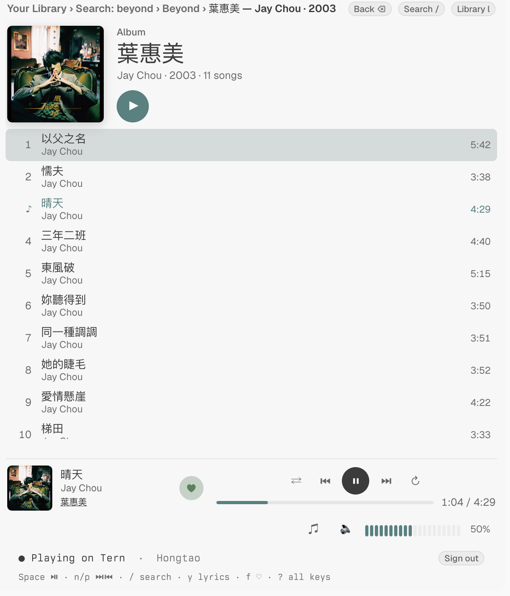
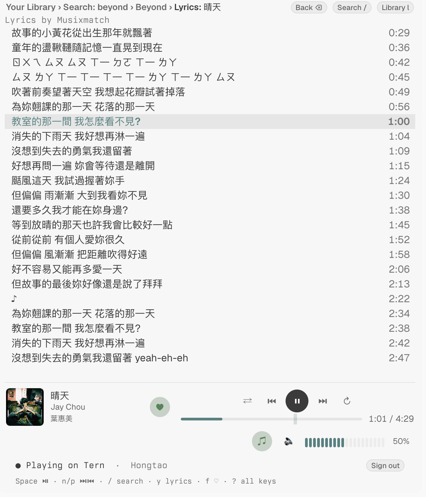
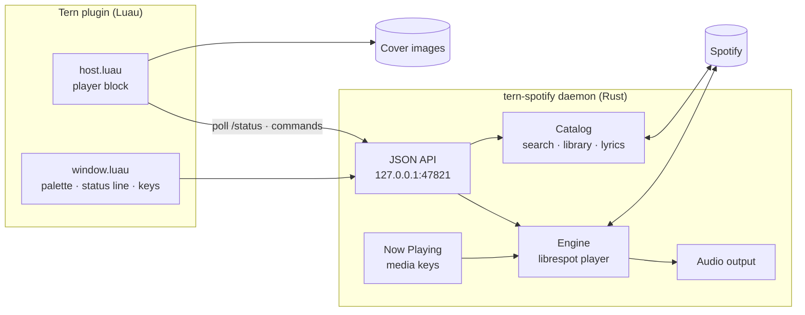
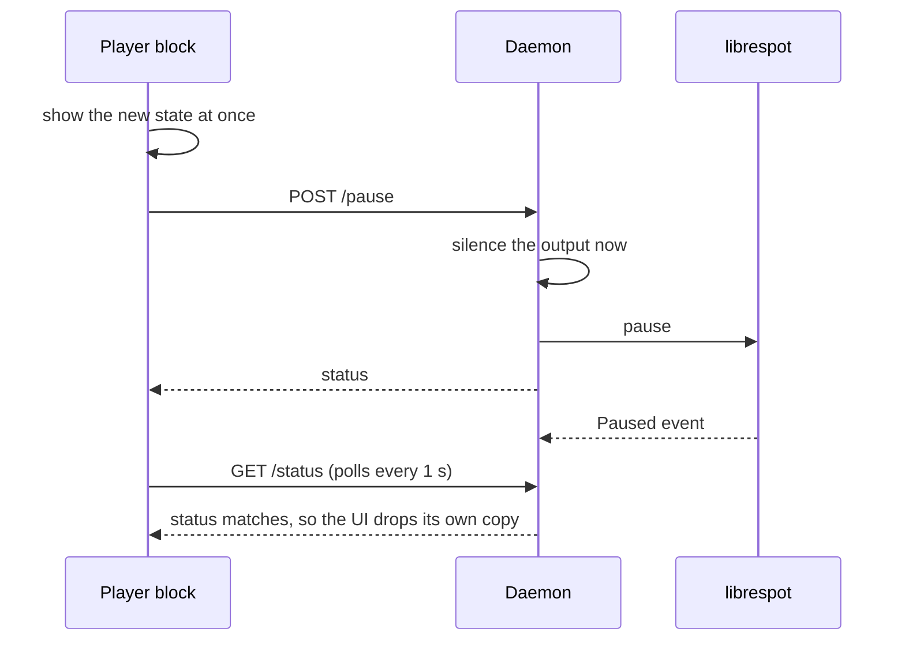

# tern-spotify

A Spotify player for [Tern](https://tern.sh). A Rust daemon built on
[librespot](https://github.com/librespot-org/librespot) plays the audio. It
shows up as a Spotify Connect device named **Tern**. The Luau plugin is the
front end. Spotify Premium is required.

| Library and player bar | Album | Synced lyrics |
| --- | --- | --- |
|  |  |  |



The daemon runs separately from Tern, so music keeps playing when the block
closes or the plugin reloads. **Spotify: Quit Player** stops it. When the
connection to Spotify drops, the daemon reconnects within a second and
picks playback back up at the same song and position. It doesn't wait for
the next song to fail on the dead connection.

## Install

```sh
cd daemon && cargo build --release --locked
tern plugin link /path/to/tern-spotify
```

Open **Spotify: Open Player** from the palette, then **Sign in with
Spotify**. The block starts the daemon itself when nothing answers on the
port.

## How a click becomes sound



When the daemon refuses a command, the UI goes back to the daemon's state at
once. When librespot drops a command, the UI goes back after 3 s. librespot
drops commands while another device is active; press **Play here** (`t`)
first.

## Keys

| Key | Does |
| --- | --- |
| `Space` | Play / pause |
| `n` / `p` | Next / previous |
| `←` / `→` | Seek 10 s (or click the bar) |
| `+` `-` / `1`–`0` / `m` | Volume / mute |
| `s` / `r` | Shuffle / repeat |
| `f` / `y` | ♡ Like / lyrics |
| `/` / `l` | Search / library |
| `⏎` / `a` / `⌫` | Open or play / play all / back |
| `t` | Play here |
| `?` | All keys |

The palette commands work without the block, including **Play/Pause**
(`⌃⌥P`), **Next** (`⌃⌥N`) and **Previous** (`⌃⌥B`).

## Development

```sh
cd daemon && cargo clippy --release
python3 tests/smoke.py          # isolated Tern, signed out
python3 tests/smoke.py --live   # signed in; quit your own player first
```

The daemon's routes are listed at the top of `daemon/src/api.rs`.
